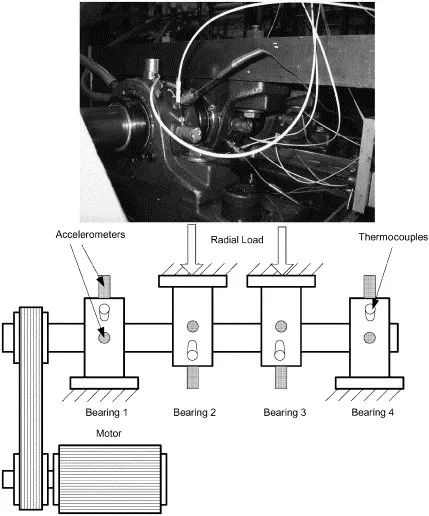
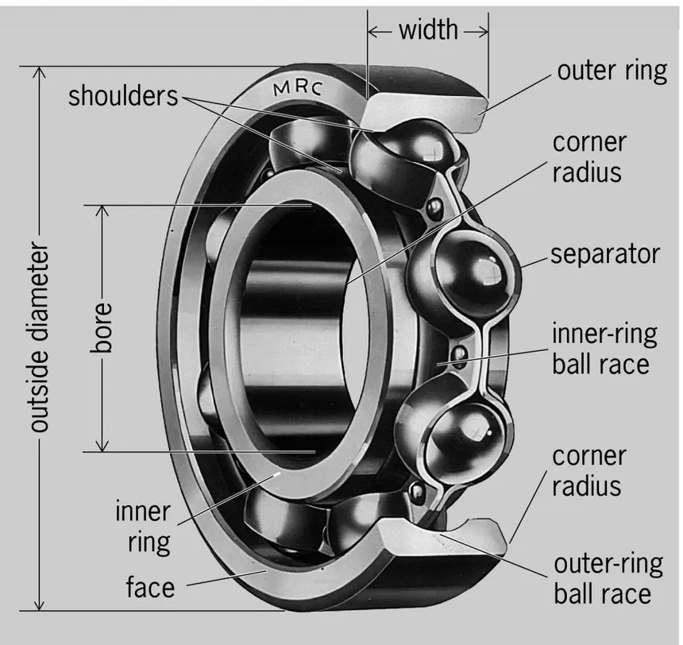

# Autoencoder NASA IMS — Bearing Anomaly Detection

Detecção não-supervisionada de anomalias em rolamentos industriais via autoencoders neurais e baselines clássicos.  
Dataset: [NASA IMS Bearings](https://data.nasa.gov/dataset/ims-bearings) — Center for Intelligent Maintenance Systems (IMS), University of Cincinnati.

> **Projeto de pesquisa em PHM (*Prognostics and Health Management*).** Prioridade: reprodutibilidade estrita, zero vazamento de dados (*data leakage*), explicabilidade física (FFT/BPFO + RUL) e comparabilidade justa entre modelos.

---

## Atalhos Rápidos da Documentação

- **[Documentação do Dataset (`docs/data.md`)](docs/data.md)** — Parâmetros físicos da bancada, mapeamento de canais e descrição dos 3 conjuntos *run-to-failure*.
- **[Glossário Técnico e Físico (`docs/glossario.md`)](docs/glossario.md)** — Fundamentos de mecânica (eixo, partes do rolamento, vibração, RPM/Hz, cálculo da BPFO de $236{,}4\text{ Hz}$), métricas estatísticas, PHM/RUL e teoria de Autoencoders.
- **[Relatório da Análise Exploratória (`docs/eda_findings.md`)](docs/eda_findings.md)** — Formulações matemáticas das features (domínio do tempo e FFT), justificativa das zonas temporais e análise física dos canais.
- **[Comparativo Global dos Modelos (`docs/baseline_comparison.md`)](docs/baseline_comparison.md)** — Resultados consolidados nas 3 seeds (`PCA`, `Isolation Forest`, `MLP`, `Conv1D`, `LSTM`) e análise de explicabilidade.
- **[Contexto Geral do Projeto (`docs/project_context.md`)](docs/project_context.md)** — Arquitetura completa, regras invioláveis do protocolo experimental e diretrizes de reprodutibilidade.

---

## Objetivo

1. Treinar modelos de detecção de anomalias **exclusivamente com dados saudáveis** do início de vida útil do rolamento.
2. Detectar o início da degradação pelo aumento do erro de reconstrução / score de anomalia e medir a **antecedência de detecção (RUL no 1º alarme sustentado)**.
3. Comparar três arquiteturas de Autoencoders (**MLP denso**, **Conv1D**, **LSTM**) e dois baselines (**PCA**, **Isolation Forest**) sob o mesmo protocolo experimental.

---

## Sistema Físico e Bancada Experimental (NASA IMS)

| Bancada de Testes NASA IMS | Componentes Internos do Rolamento |
| :---: | :---: |
|  |  |
| *Diagrama do motor elétrico, eixo rotativo, 4 rolamentos sob carga radial de 6.000 lbs e acelerômetros, com foto superior do rolamento Rexnord ZA-2115 estudado.* | *Anatomia de um rolamento: pista externa (outer ring), pista interna (inner ring), elementos rolantes (rolling elements) e gaiola (cage).* |

---

## Arquitetura do Repositório: `src/` vs. `notebooks/`

O projeto está organizado em duas frentes complementares:

1. **`src/` (Pipeline Modular de Execução Direta):**
   Contém a implementação produtiva e automatizada do experimento. Executa desde a extração e validação dos arquivos brutos (`extractor.py`, `loader.py`, `features.py`, `preprocessor.py`) até o treinamento multi-seed, avaliação PHM/RUL, verificação física por FFT e geração automática de relatórios e gráficos (`trainer.py`, `autoencoder.py`, `anomaly_detector.py`, `metrics.py`, `visualization.py`).
2. **`notebooks/` (Ambiente Interativo de Estudo):**
   Ambiente de exploração passo a passo desenvolvido para estudo didático, inspeção visual dos sinais de vibração, pré-processamento transparente e experimentação prática com o Autoencoder (`01_EDA.ipynb`, `02_preprocess.ipynb`, `03_modeling.ipynb`), além de análises complementares (`01_EDA_01.ipynb`, `04_cross_bearing_eval.ipynb`).

### Estrutura do Projeto

```text
autoencoder_nasa_ims/
├── configs/
│   ├── data.yaml                  # Parâmetros físicos do dataset e bandas FFT (fonte: PDF README)
│   ├── labeling.yaml              # Split temporal treino/cinza/val/teste — congelado pós-EDA
│   ├── eval.yaml                  # Protocolo de avaliação PHM e definição de métricas/seeds
│   └── models.yaml                # Hiperparâmetros dos baselines e Autoencoders (MLP, Conv1D, LSTM)
│
├── data/
│   ├── raw/                       # IMUTÁVEL — arquivos RAR originais e PDF README da NASA
│   ├── interim/                   # Snapshots ASCII extraídos (20.480 pontos/arquivo) + logs
│   └── processed/                 # Features extraídas e splits temporais materializados
│       ├── train/                 # 2nd_test_train.csv (saudável: 0..400)
│       ├── val/                   # 2nd_test_val.csv   (calibração de limiar: 451..530)
│       └── test/                  # 2nd_test_test.csv  (degradação/falha: 531..981)
│
├── docs/
│   ├── artigos/                   # Artigos científicos e referências bibliográficas de apoio
│   ├── img/                       # Ilustrações técnicas da bancada e anatomia do rolamento
│   │   ├── IMS_testsetup.webp     # Diagrama do motor, eixo, rolamentos, acelerômetros e foto da peça
│   │   └── bearing.webp           # Partes constituintes do rolamento (pistas, rolos e gaiola)
│   ├── project_context.md         # Contexto geral, regras invioláveis e arquitetura do projeto
│   ├── data.md                    # Documentação técnica do dataset NASA IMS
│   ├── glossario.md               # Glossário de mecânica/vibração (FFT, BPFO, RUL) e Autoencoders
│   ├── eda_findings.md            # Relatório da EDA, fórmulas das features e justificativa de zonas
│   └── baseline_comparison.md     # Comparativo global dos 5 modelos (PCA, IF, MLP, Conv1D, LSTM)
│
├── experiments/                   # Artefatos gerados pela execução direta do pipeline (src/)
│   ├── registry.csv               # Tabela central com histórico e métricas de todas as runs
│   ├── pca/                       # Runs por seed + summary_metrics.json (PCA)
│   ├── isolation_forest/          # Runs por seed + summary_metrics.json (Isolation Forest)
│   ├── mlp/                       # Runs por seed + summary_metrics.json (MLP Autoencoder)
│   ├── conv1d/                    # Runs por seed + summary_metrics.json (Conv1D Autoencoder)
│   └── lstm/                      # Runs por seed + summary_metrics.json (LSTM Autoencoder)
│
├── notebooks/                     # Ambiente interativo de estudo e experimentação passo a passo
│   ├── 01_EDA.ipynb               # Estudo exploratório de sinais, evolução temporal e zonas
│   ├── 01_EDA_01.ipynb            # Análise exploratória integrada aos módulos de visualização de src/
│   ├── 02_preprocess.ipynb        # Estudo de extração de features, split temporal e normalização
│   ├── 03_modeling.ipynb          # Treinamento passo a passo do MLP Autoencoder e detecção de RUL
│   ├── 04_cross_bearing_eval.ipynb# Avaliação cruzada de generalização entre rolamentos/testes
│   └── models/                    # Pesos e predições salvos durante os estudos nos notebooks
│
├── reports/                       # Gráficos e figuras consolidados na raiz do projeto
│   ├── eda_zones_timeline.png     # Série temporal multicanal com demarcação das zonas do protocolo
│   ├── eda_waveform_comparison.png# Comparação das formas de onda brutas (Saudável, Degradação, Falha)
│   ├── eda_fft_spectrum.png       # Espectros FFT destacando a frequência de falha BPFO (~236,4 Hz)
│   └── evolucao_completa_rolamento_1.png # Painel de evolução física do Rolamento 1
│
├── src/                           # Modelo e pipeline modular de execução direta (CLI)
│   ├── data/                      # extractor.py, loader.py, features.py, preprocessor.py
│   ├── models/                    # anomaly_detector.py (PCA, IF) + autoencoder.py (MLP, Conv1D, LSTM)
│   ├── training/                  # trainer.py (runner unificado) + callbacks.py
│   └── utils/                     # metrics.py, visualization.py, seed.py
│
├── pyproject.toml
└── uv.lock
```

---

## Setup e Execução Direta (`src/`)

```powershell
# 1. Instalar dependências (PyTorch CUDA 12.8 — roda em GPU RTX 3060 ou CPU automaticamente)
uv sync

# 2. Executar os baselines clássicos (PCA e Isolation Forest) nas 3 seeds [42, 123, 456]
.venv\Scripts\python.exe -m src.training.trainer --model all_baselines --allow-dirty

# 3. Executar os Autoencoders neurais (MLP, Conv1D e LSTM) nas 3 seeds [42, 123, 456]
.venv\Scripts\python.exe -m src.training.trainer --model all_ae --allow-dirty

# 4. Executar todos os 5 modelos de uma vez
.venv\Scripts\python.exe -m src.training.trainer --model all --allow-dirty
```

---

## Protocolo Experimental

- **Split estritamente temporal** (definido em [`configs/labeling.yaml`](configs/labeling.yaml)):
  - `Treino (0..400)` → `Zona Cinza excluída (401..450)` → `Validação (451..530)` → `Teste/Degradação (531..981)` → `Desligamento excluído (982..983)`.
- **Normalização sem vazamento:** `StandardScaler` ajustado (`fit`) exclusivamente no treino e salvo em cada run (`scaler.pkl`).
- **Limiar de anomalia:** Percentil 99 do erro de reconstrução/isolamento saudável, sem jamais observar o conjunto de teste.
- **Reprodutibilidade:** 3 seeds fixas (`42, 123, 456`); resultados reportados como **média ± desvio padrão**.
- **Explicabilidade Física (FFT + RUL):** Cada run salva automaticamente o painel `explainability_fft_rul.png` (confirmando o crescimento de energia na frequência de defeito da pista externa **BPFO ≈ 236,4 Hz** e o ranking de contribuição das features) e `reconstruction_error_timeline.png` (com a contagem regressiva do **RUL** no instante do 1º alarme sustentado).
